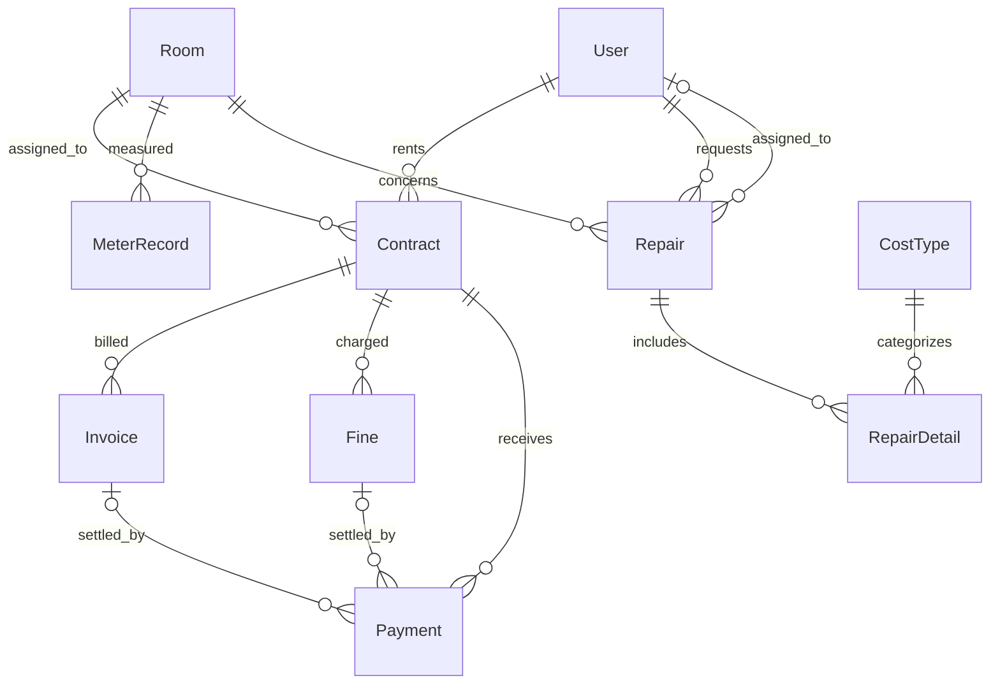

# Fah Sai Place Dormitory Management

ระบบจัดการหอพักฟ้าใสเพลส พัฒนาด้วย PHP 8.2, MySQL, HTML, CSS และ JavaScript สำหรับ XAMPP

## ขอบเขต

รองรับผู้ใช้งาน 4 บทบาท ได้แก่ Tenant, Staff, Admin และ Technician (ช่างซ่อม) พร้อมการจัดการห้องพักและสัญญาเช่า บันทึกมิเตอร์ ออกใบแจ้งหนี้รายเดือน บันทึกค่าปรับ ตรวจสอบการชำระเงินและหลักฐาน แจ้งซ่อม มอบหมายและติดตามงาน รายละเอียดค่าใช้จ่ายซ่อม ข่าวสาร และรายงานรายรับ ยอดค้าง และรายการแจ้งซ่อมประจำวัน/สัปดาห์ ผู้ใช้ทุกบทบาทแก้ไขข้อมูลส่วนตัวและรูปโปรไฟล์ได้ Staff แก้ไขรายละเอียดห้องได้ ส่วน Admin จัดการบัญชีและสัญญาได้ กระดานข่าวรองรับรูปประกาศและเปิดดูรายละเอียดในป็อปอัพ

ฐานข้อมูลมี 11 ตาราง: ตารางเดิม 9 ตารางจาก Data Dictionary บทที่ 3 (`User`, `Room`, `Contract`, `Payment`, `MeterRecord`, `Repair`, `RepairDetail`, `CostType`, `News`) และเพิ่ม `Invoice` กับ `Fine` เพื่อรองรับการเก็บใบแจ้งหนี้และค่าปรับตามขอบเขตระบบ ตาราง `User` เก็บชื่อไฟล์รูปโปรไฟล์และ `News` เก็บชื่อไฟล์รูปประกาศ ตาราง `Repair` มี `maintenanceUserId`, ผลซ่อม และรูปหลังซ่อมเพื่อรองรับ workflow การมอบหมายและติดตามงาน

`Invoice` เก็บยอดค่าเช่าและหน่วยน้ำ/ไฟพร้อมอัตราที่ใช้ ณ วันที่ออกใบแจ้งหนี้ และมีหนึ่งใบต่อสัญญาในแต่ละรอบบิล `Fine` เก็บรายละเอียดและยอดค่าปรับของสัญญา การชำระเงินใน `Payment` อ้างถึงใบแจ้งหนี้หรือค่าปรับได้ ส่วนรายการชำระเดิมที่ไม่มีการอ้างอิงยังคงอยู่ได้ ข้อมูล invoice/fine เป็นส่วนขยายจาก Data Dictionary เดิม จึงควรปรับ ERD/Class Diagram ในรายงานให้ตรงกับ schema ปัจจุบัน

ผู้ดูแลสร้างใบแจ้งหนี้รายเดือนจากหน้า “การชำระเงิน” หลังพนักงานบันทึกมิเตอร์ครบทุกสัญญาที่ใช้งานในเดือนนั้น โดยป้อนชื่อรอบบิลให้ตรงกับค่าที่บันทึกใน `MeterRecord.month` ระบบจะเก็บค่าเช่าและยอดน้ำ/ไฟเป็น snapshot และป้องกันการออกซ้ำต่อสัญญา/เดือน ผู้ดูแลบันทึกค่าปรับจากหน้าเดียวกัน ผู้เช่าส่งหลักฐานชำระได้เฉพาะใบแจ้งหนี้หรือค่าปรับที่ยังค้าง และเมื่อผู้ดูแลอนุมัติ ระบบปรับสถานะรายการนั้นเป็น “ชำระแล้ว”

## ติดตั้งบน XAMPP

1. วางโฟลเดอร์โปรเจกต์ไว้ใน `C:\xampp\htdocs\fasai` หรือโฟลเดอร์ `htdocs` ของ XAMPP
2. เปิด Apache และ MySQL ใน XAMPP Control Panel
3. เข้า phpMyAdmin แล้ว Import ไฟล์ `database/schema.sql`
4. เปิด `http://127.0.0.1/fasai/`
5. หากใช้ฐานข้อมูลในเครื่อง ให้กำหนด `DB_HOST`, `DB_DATABASE`, `DB_USERNAME` และ `DB_PASSWORD` ในไฟล์ `.env` ให้ตรงกับ MySQL ใน XAMPP

## ติดตั้งบน InfinityFree (Linux)

1. สร้าง MySQL database ใน InfinityFree Control Panel แล้ว Import `database/schema.sql` ผ่าน phpMyAdmin ที่โฮสต์จัดให้
2. คัดลอกไฟล์โปรเจกต์ไปไว้ใน `htdocs` โดยให้ `index.php` อยู่ตรงรากเว็บ
3. คัดลอก `.env.example` เป็น `.env` แล้วตรวจให้ค่า `DB_HOST`, `DB_DATABASE` และ `DB_USERNAME` ตรงกับฐานข้อมูล InfinityFree พร้อมกำหนด `DB_PASSWORD` จาก Hosting Control Panel
4. เปิดเว็บไซต์ด้วยโดเมนที่ผูกไว้กับบัญชี

แอปอ่านค่าจาก environment variables ก่อน แล้วจึงอ่าน `.env`; ค่าเริ่มต้นเป็นค่าการเชื่อมต่อ InfinityFree ไฟล์ `.env` ถูกละเว้นโดย Git และป้องกันการเรียกดูผ่าน `.htaccess` ห้ามลบไฟล์ `.htaccess` ออกจากเว็บโฮสต์ แอปใช้ path แบบ relative สำหรับลิงก์และฟอร์ม จึงไม่ผูกกับชื่อโดเมนเฉพาะ

หากอัปเกรดฐานข้อมูลเดิมที่สร้างก่อนรองรับรูปโปรไฟล์และรูปประกาศ ให้รันคำสั่งต่อไปนี้หนึ่งครั้งใน phpMyAdmin ก่อนเปิดแอป:

```sql
ALTER TABLE `User` ADD COLUMN profileImage VARCHAR(255) DEFAULT NULL;
ALTER TABLE News ADD COLUMN image VARCHAR(255) DEFAULT NULL;
```

หากอัปเกรดฐานข้อมูลเดิม ให้รัน `database/migrations/20261030_billing.sql` หนึ่งครั้งใน phpMyAdmin เพื่อเพิ่มตาราง `Invoice` และ `Fine` และเพิ่มการอ้างอิงใน `Payment` (อย่ารัน migration ซ้ำ) หากฐานข้อมูลยังไม่มีคอลัมน์รูปโปรไฟล์/รูปประกาศ ให้รันคำสั่ง ALTER TABLE ด้านบนก่อน migration นี้

## โครงสร้างความสัมพันธ์ข้อมูลปัจจุบัน



## บัญชีผู้ใช้

เริ่มต้นสร้างบัญชี Admin ผ่านหน้าตั้งค่าครั้งแรกของระบบ โดยใช้รหัสผ่านที่ระบบแฮชด้วย `password_hash()` หน้า “บัญชีผู้ใช้งาน” กำหนดรหัสผ่านใหม่อย่างน้อย 12 ตัวอักษร และต้องมีตัวพิมพ์เล็ก ตัวพิมพ์ใหญ่ ตัวเลข และอักขระพิเศษ พร้อมยืนยันรหัสผ่านอีกครั้ง ห้ามนำรหัสผ่านตัวอย่างหรือข้อมูลส่วนบุคคลจากรายงานไปใช้จริง

## อัตราค่าสาธารณูปโภค

ค่าเริ่มต้นสำหรับการคำนวณในแอปคือค่าน้ำ 18 บาท/หน่วย และค่าไฟ 8 บาท/หน่วย สามารถแก้ได้ที่ `app/bootstrap.php` ให้ตรงกับอัตราจริงของหอพักก่อนใช้งาน

## ความปลอดภัยและการใช้งานจริง

ระบบควรให้บริการผ่าน HTTPS เมื่อเผยแพร่จริง, เปลี่ยนรหัสผ่าน MySQL เริ่มต้น, จำกัดขนาดและชนิดไฟล์อัปโหลด, สำรองฐานข้อมูลเป็นประจำ และสร้างบัญชีผู้ใช้ด้วยรหัสผ่านที่ปลอดภัย

รูปสลิป รูปโปรไฟล์ และรูปประกาศจำกัดชนิด JPG/PNG/WEBP และขนาดไม่เกิน 5 MB โดยเปิดดูผ่าน `file.php` หลังตรวจสิทธิ์ ศูนย์ช่วยเหลือใช้เบอร์โทรและอีเมลของบัญชี Admin ในระบบ จึงควรกรอกข้อมูลติดต่อของผู้ดูแลให้เป็นปัจจุบัน
