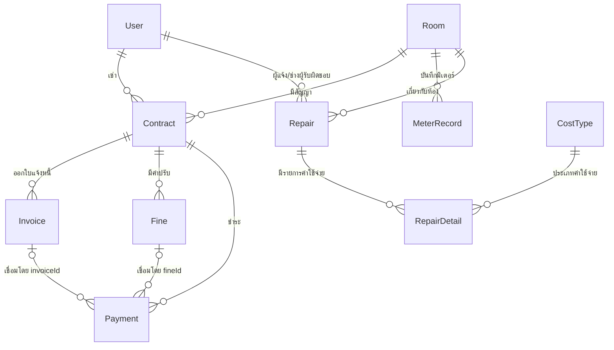

# คำอธิบายฐานข้อมูล ฟ้าใสเพลส

## ภาพรวม

ฐานข้อมูลใช้ MySQL/InnoDB จำนวน 11 ตาราง รหัสผ่านผู้ใช้เก็บเป็น hash โดย `password_hash()` ไม่เก็บรหัสผ่านแบบ plain text ตารางหลักและตารางส่วนขยายเชื่อมกันด้วย Primary Key และ Foreign Key ดังนี้

## 1. ตาราง `User`

เก็บบัญชีผู้ใช้และแบ่งสิทธิ์เป็น `Tenant`, `Staff`, `Admin`, `Technician`

| Field | ประเภทข้อมูล | กุญแจ | คำอธิบาย |
|---|---|---|---|
| `userId` | VARCHAR(8) | **PK** | รหัสผู้ใช้ |
| `username` | VARCHAR(50) | UNIQUE | ชื่อเข้าสู่ระบบ |
| `password` | VARCHAR(255) | - | รหัสผ่านแบบ hash |
| `name` | VARCHAR(100) | - | ชื่อผู้ใช้ |
| `phone` | VARCHAR(10) | - | เบอร์โทรศัพท์ |
| `email` | VARCHAR(100) | UNIQUE | อีเมล |
| `role` | ENUM | - | Tenant, Staff, Admin หรือ Technician |
| `profileImage` | VARCHAR(255) | - | ชื่อไฟล์รูปโปรไฟล์ |

## 2. ตาราง `Room`

เก็บข้อมูลห้องและค่าเช่า

| Field | ประเภทข้อมูล | กุญแจ | คำอธิบาย |
|---|---|---|---|
| `roomId` | VARCHAR(9) | **PK** | รหัสห้อง |
| `roomNumber` | VARCHAR(20) | UNIQUE | เลขห้อง |
| `roomStatus` | VARCHAR(30) | - | ว่าง, มีผู้เช่า หรือ ปิดปรับปรุง |
| `rentalPrice` | DECIMAL(10,2) | - | ค่าเช่ารายเดือน ต้องไม่ติดลบ |

## 3. ตาราง `Contract`

เชื่อมผู้เช่าเข้ากับห้องพัก

| Field | ประเภทข้อมูล | กุญแจ | คำอธิบาย |
|---|---|---|---|
| `contractId` | VARCHAR(12) | **PK** | รหัสสัญญา |
| `userId` | VARCHAR(8) | **FK → User(userId)** | ผู้เช่า |
| `roomId` | VARCHAR(9) | **FK → Room(roomId)** | ห้องที่เช่า |
| `startDate` | DATE | - | วันที่เริ่มสัญญา |
| `endDate` | DATE | - | วันที่สิ้นสุดสัญญา |
| `deposit` | DECIMAL(10,2) | - | เงินประกัน |
| `status` | VARCHAR(50) | - | ใช้งานอยู่หรือสิ้นสุดแล้ว |

## 4. ตาราง `Invoice`

เก็บ snapshot ใบแจ้งหนี้รายเดือน

| Field | ประเภทข้อมูล | กุญแจ | คำอธิบาย |
|---|---|---|---|
| `invoiceId` | VARCHAR(16) | **PK** | รหัสใบแจ้งหนี้ |
| `contractId` | VARCHAR(12) | **FK → Contract(contractId)** | สัญญาเจ้าของใบแจ้งหนี้ |
| `billMonth` | VARCHAR(20) | UNIQUE ร่วม | รอบบิล รูปแบบ MM/YYYY |
| `dueDate` | DATE | - | วันครบกำหนด |
| `rentAmount` | DECIMAL(10,2) | - | ค่าเช่า ณ วันที่ออกใบ |
| `waterUnit` | DECIMAL(10,2) | - | หน่วยน้ำ |
| `electricUnit` | DECIMAL(10,2) | - | หน่วยไฟ |
| `waterRate` | DECIMAL(10,2) | - | อัตราค่าน้ำต่อหน่วย |
| `electricRate` | DECIMAL(10,2) | - | อัตราค่าไฟต่อหน่วย |
| `status` | VARCHAR(30) | - | รอชำระหรือชำระแล้ว |

`UNIQUE(contractId, billMonth)` ทำให้สัญญาหนึ่งมีใบแจ้งหนี้ได้หนึ่งใบต่อรอบบิล

## 5. ตาราง `Fine`

เก็บค่าปรับของผู้เช่า

| Field | ประเภทข้อมูล | กุญแจ | คำอธิบาย |
|---|---|---|---|
| `fineId` | VARCHAR(16) | **PK** | รหัสค่าปรับ |
| `contractId` | VARCHAR(12) | **FK → Contract(contractId)** | สัญญาเจ้าของค่าปรับ |
| `fineDate` | DATE | - | วันที่บันทึก |
| `description` | VARCHAR(500) | - | รายละเอียดค่าปรับ |
| `amount` | DECIMAL(10,2) | - | จำนวนเงิน ต้องมากกว่า 0 |
| `status` | VARCHAR(30) | - | รอชำระหรือชำระแล้ว |

## 6. ตาราง `Payment`

เก็บหลักฐานการชำระเงิน

| Field | ประเภทข้อมูล | กุญแจ | คำอธิบาย |
|---|---|---|---|
| `paymentId` | VARCHAR(12) | **PK** | รหัสการชำระ |
| `contractId` | VARCHAR(12) | **FK → Contract(contractId)** | สัญญาผู้เช่าที่ชำระ |
| `invoiceId` | VARCHAR(16) | **FK → Invoice(invoiceId)** หรือ NULL | ใบแจ้งหนี้ที่ชำระ |
| `fineId` | VARCHAR(16) | **FK → Fine(fineId)** หรือ NULL | ค่าปรับที่ชำระ |
| `paymentDate` | DATE | - | วันที่ชำระ |
| `amount` | DECIMAL(10,2) | - | จำนวนเงิน |
| `evidence` | VARCHAR(255) | - | ชื่อไฟล์หลักฐาน |
| `status` | VARCHAR(30) | - | รอตรวจสอบ, อนุมัติ หรือ ปฏิเสธ |

เงื่อนไข `invoiceId IS NULL OR fineId IS NULL` กำหนดว่าการชำระหนึ่งรายการอ้างถึงได้เพียงใบแจ้งหนี้หรือค่าปรับหนึ่งรายการ ไม่ใช่ทั้งสองรายการพร้อมกัน

## 7. ตาราง `MeterRecord`

เก็บมิเตอร์น้ำและไฟตามรอบเดือนของห้อง

| Field | ประเภทข้อมูล | กุญแจ | คำอธิบาย |
|---|---|---|---|
| `meterId` | VARCHAR(12) | **PK** | รหัสบันทึกมิเตอร์ |
| `roomId` | VARCHAR(9) | **FK → Room(roomId)** | ห้องที่บันทึก |
| `waterUnit` | DECIMAL(10,2) | - | หน่วยน้ำ |
| `electricUnit` | DECIMAL(10,2) | - | หน่วยไฟ |
| `recordDate` | DATE | - | วันที่บันทึกจริง |
| `month` | VARCHAR(20) | UNIQUE ร่วมกับ roomId | รอบมิเตอร์ |

`UNIQUE(roomId, month)` ห้ามบันทึกมิเตอร์ซ้ำห้องและรอบเดือนเดียวกัน

## 8. ตาราง `Repair`

เก็บคำร้องแจ้งซ่อมและสถานะงานซ่อม

| Field | ประเภทข้อมูล | กุญแจ | คำอธิบาย |
|---|---|---|---|
| `repairId` | VARCHAR(12) | **PK** | รหัสงานซ่อม |
| `userId` | VARCHAR(8) | **FK → User(userId)** | ผู้แจ้งซ่อม |
| `roomId` | VARCHAR(9) | **FK → Room(roomId)** | ห้องที่แจ้งซ่อม |
| `maintenanceUserId` | VARCHAR(8) | **FK → User(userId)** หรือ NULL | ช่างผู้รับผิดชอบ |
| `detail` | VARCHAR(500) | - | รายละเอียดปัญหา |
| `image` | VARCHAR(255) | - | รูปประกอบก่อนซ่อม |
| `repairResult` | TEXT | - | ผลการซ่อม |
| `completionImage` | VARCHAR(255) | - | รูปหลังซ่อม |
| `repairStatus` | VARCHAR(30) | - | สถานะงานซ่อม |
| `repairDate` | DATE | - | วันที่แจ้งซ่อม |

## 9. ตาราง `CostType`

เก็บประเภทค่าใช้จ่ายการซ่อม

| Field | ประเภทข้อมูล | กุญแจ | คำอธิบาย |
|---|---|---|---|
| `costTypeId` | VARCHAR(5) | **PK** | รหัสประเภทค่าใช้จ่าย |
| `costTypeName` | VARCHAR(100) | UNIQUE | ชื่อประเภทค่าใช้จ่าย |

## 10. ตาราง `RepairDetail`

เก็บรายการอุปกรณ์และค่าใช้จ่ายแต่ละงานซ่อม

| Field | ประเภทข้อมูล | กุญแจ | คำอธิบาย |
|---|---|---|---|
| `repairId` | VARCHAR(12) | **PK, FK → Repair(repairId)** | งานซ่อม |
| `costTypeId` | VARCHAR(5) | **PK, FK → CostType(costTypeId)** | ประเภทค่าใช้จ่าย |
| `equipment` | VARCHAR(100) | - | รายการอุปกรณ์หรือค่าแรง |
| `amount` | DECIMAL(10,2) | - | จำนวนเงิน |

Primary Key แบบ composite คือ `(repairId, costTypeId)` ทำให้งานซ่อมหนึ่งงานมีได้หนึ่งรายการต่อหนึ่งประเภทค่าใช้จ่าย

## 11. ตาราง `News`

เก็บประกาศข่าวสาร

| Field | ประเภทข้อมูล | กุญแจ | คำอธิบาย |
|---|---|---|---|
| `newsId` | VARCHAR(13) | **PK** | รหัสข่าว |
| `title` | VARCHAR(200) | - | หัวข้อ |
| `detail` | VARCHAR(1000) | - | รายละเอียด |
| `publishDate` | DATE | - | วันที่เผยแพร่ |
| `image` | VARCHAR(255) | - | ชื่อไฟล์รูปประกาศ |

## ความหมายของความสัมพันธ์แบบเข้าใจง่าย

### PK คืออะไร

**Primary Key (PK)** คือรหัสที่ระบุตัวตนของแถวหนึ่งแถวในตาราง โดยห้ามซ้ำกัน เช่น

- `User.userId` ระบุตัวตนของผู้ใช้คนหนึ่ง
- `Room.roomId` ระบุตัวตนของห้องหนึ่งห้อง
- `Contract.contractId` ระบุตัวตนของสัญญาหนึ่งสัญญา

### FK คืออะไร

**Foreign Key (FK)** คือคอลัมน์ที่เก็บรหัส PK ของตารางอื่นเพื่อเชื่อมข้อมูล เช่น

- `Contract.userId` เก็บ `User.userId`
- `Contract.roomId` เก็บ `Room.roomId`
- เลขใน `Contract.userId` ต้องมีอยู่ใน `User.userId` จึงจะบันทึกสัญญาได้

### อ่านความสัมพันธ์ด้วยคำว่า “หนึ่ง..มีได้กี่..”

| ความสัมพันธ์ | คำอธิบายสำหรับนำเสนอ |
|---|---|
| User → Contract | ผู้ใช้หนึ่งคนมีสัญญาเช่าได้หลายสัญญา แต่ละสัญญาเชื่อมกับผู้ใช้หนึ่งคน |
| Room → Contract | ห้องหนึ่งห้องมีประวัติสัญญาได้หลายสัญญา ในช่วงเวลาเดียวกันควรมีสัญญาใช้งานอยู่เพียงหนึ่งสัญญา |
| Contract → Invoice | สัญญาหนึ่งสัญญาออกใบแจ้งหนี้ได้หลายรอบบิล |
| Contract → Fine | สัญญาหนึ่งสัญญามีค่าปรับได้หลายรายการ |
| Contract → Payment | สัญญาหนึ่งสัญญามีประวัติการชำระได้หลายรายการ |
| Invoice → Payment | ใบแจ้งหนี้หนึ่งใบมีการชำระได้หลายครั้งในประวัติ แต่หลักฐานรอตรวจสอบจะอนุญาตหนึ่งรายการต่อครั้ง |
| Fine → Payment | ค่าปรับหนึ่งรายการชำระด้วยการชำระหนึ่งรายการเมื่ออนุมัติ |
| Room → MeterRecord | ห้องหนึ่งห้องมีบันทึกมิเตอร์ได้หลายเดือน แต่หนึ่งเดือนบันทึกได้เพียงครั้งเดียว |
| User → Repair | ผู้ใช้หนึ่งคนเป็นผู้แจ้งซ่อมได้หลายรายการ |
| Room → Repair | ห้องหนึ่งห้องมีรายการแจ้งซ่อมได้หลายรายการ |
| User → Repair | ช่างผู้ใช้หนึ่งคนรับผิดชอบงานซ่อมได้หลายรายการผ่าน `maintenanceUserId` |
| Repair → RepairDetail | งานซ่อมหนึ่งงานมีรายการค่าใช้จ่ายได้หลายประเภท |
| CostType → RepairDetail | ประเภทค่าใช้จ่ายหนึ่งประเภทถูกใช้ในรายการซ่อมได้หลายรายการ |

## ตัวอย่างการเชื่อมข้อมูลจริง

สมมติฐานข้อมูลมีผู้ใช้ แค่รหัส `USR-0004` และห้องรหัส `ROOM-0001`

1. ระบบมีผู้ใช้คนหนึ่งในตาราง `User`
   - `USR-0004` = ผู้เช่าทดสอบ
2. ระบบสร้างสัญญา `CON-2026-001`
   - `Contract.userId = USR-0004`
   - `Contract.roomId = ROOM-0001`
   - จึงทราบว่าสัญญานี้เป็นของผู้เช่าทดสอบและห้อง 1
3. ระบบออกใบแจ้งหนี้ `INV-2026-001`
   - `Invoice.contractId = CON-2026-001`
   - จึงทราบว่าใบนี้ออกให้สัญญาห้อง 1 ของผู้เช่ารายนั้น
4. ผู้เช่าส่งหลักฐานชำระใบแจ้งหนี้
   - `Payment.contractId = CON-2026-001`
   - `Payment.invoiceId = INV-2026-001`
   - `Payment.fineId = NULL`
   - แปลว่าการชำระรายการนี้เป็นของสัญญาและเชื่อมกับใบแจ้งหนี้ใบนี้

### ตารางคู่และคอลัมน์ที่เชื่อม

| ตารางต้นทาง | คอลัมน์ FK | ตารางปลายทาง | คอลัมน์ PK | ความหมาย |
|---|---|---|---|---|
| `Contract` | `userId` | `User` | `userId` | ผู้เช่าเป็นเจ้าของสัญญา |
| `Contract` | `roomId` | `Room` | `roomId` | สัญญาเชื่อมกับห้องใด |
| `Invoice` | `contractId` | `Contract` | `contractId` | ใบแจ้งหนี้ออกจากสัญญาใด |
| `Fine` | `contractId` | `Contract` | `contractId` | ค่าปรับของสัญญาใด |
| `Payment` | `contractId` | `Contract` | `contractId` | ใครเป็นผู้ชำระผ่านสัญญาใด |
| `Payment` | `invoiceId` | `Invoice` | `invoiceId` | ชำระใบแจ้งหนี้ใด |
| `Payment` | `fineId` | `Fine` | `fineId` | ชำระค่าปรับใด |
| `MeterRecord` | `roomId` | `Room` | `roomId` | มิเตอร์ของห้องใด |
| `Repair` | `userId` | `User` | `userId` | ใครเป็นผู้แจ้งซ่อม |
| `Repair` | `roomId` | `Room` | `roomId` | แจ้งซ่อมห้องใด |
| `Repair` | `maintenanceUserId` | `User` | `userId` | ใครเป็นช่างรับผิดชอบ |
| `RepairDetail` | `repairId` | `Repair` | `repairId` | รายละเอียดอยู่ในงานซ่อมใด |
| `RepairDetail` | `costTypeId` | `CostType` | `costTypeId` | รายการนี้เป็นประเภทค่าใช้จ่ายใด |
